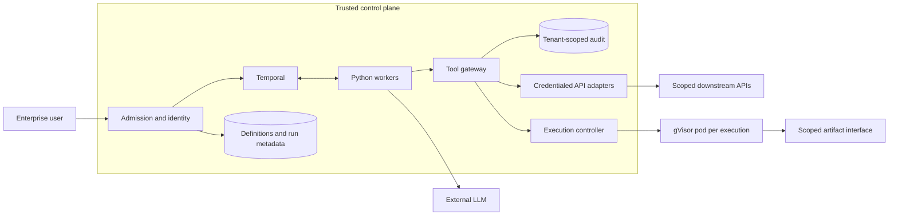

# Agentic orchestration framework

## 1. Runtime and trust boundaries

An agent run is a **Temporal workflow instance**. A versioned definition pins the prompt, model, tool grants, execution profile, owner, and budgets. PostgreSQL stores immutable definitions and run metadata. Python workers execute activities. Temporal owns durable workflow progress and task queues. Kubernetes runs and scales the shared worker deployments and places execution pods. Assume a regional cluster, an external LLM, and enterprise identity at admission. Tenant isolation applies even when multiple runs use the same agent definition.

Admission authenticates the user, verifies tenant membership and definition access, applies tenant concurrency limits, and creates a stable run ID. Temporal routes work to activity pools by execution type and trust class. Kubernetes places trusted workers and sandbox pods in separate node pools. Only trusted services handle workload identities and secrets. Tenant keys scope database queries, artifact access, quota state, and credentials. Enforce database tenant policies with application roles that cannot bypass them. Authorize operator access to run and audit data separately.

The workflow alternates between model, tool, and user steps. It persists transitions and keeps large or sensitive inputs in tenant-scoped storage referenced by opaque IDs. A human wait uses a durable signal and timer, releasing the worker. The input endpoint reauthorizes the user and deduplicates replies by message ID. Per-step deadlines and an overall workflow deadline bound work. Cancellation stops new dispatch, requests deletion of active execution pods, and records any external effect still awaiting reconciliation. At termination, release quota reservations and expire scratch artifacts. Worker deployments keep compatible workflow code available for existing runs and route new runs to the new version.

## 2. Tool path and sandbox

1. The model sees permitted tool schemas and returns a tool name and arguments. Model output is untrusted. The worker binds the proposal to authenticated run identity and assigns a stable logical call ID and a separate attempt ID.
2. The gateway verifies the workload and run binding, then checks the versioned grant, current revocations, tenant and resource scope, payload schema, and remaining budget. Rejections go to audit without downstream dispatch.
3. The gateway durably records intent before an external effect. An API adapter resolves a tenant- and tool-scoped credential and inserts it directly into the outbound request. The adapter fixes the destination and checks downstream resource scope. The model receives no credential or raw transport error.
4. For execution calls, a controller creates a Kubernetes Job using an approved image and execution profile. It stages only authorized input artifacts. The command, exit status, and artifact references are recorded under the call ID. A restricted audit store can retain execution commands and arguments for tenant-authorized review. Keep literal credentials out of commands and treat user-supplied text and command output as sensitive.
5. The adapter validates the result against the tool's output contract. The gateway records the outcome and returns bounded fields or opaque artifact handles. The worker adds those fields to context as tool data. For write retries, reuse the logical call ID as the downstream idempotency key where supported.

Use gVisor through Kubernetes RuntimeClass to reduce direct exposure to the host kernel while retaining Linux CLI compatibility. Run as non-root with a read-only root filesystem, dropped capabilities, bounded scratch disk, CPU, memory, process limits, and a hard deadline. Disable service-account token mounts, host mounts, and privileged access. Deny ingress and egress for the execution pod by default, including access to metadata, cluster services, and the internet. Stage input and collect output through a trusted controller or scoped storage interface outside the untrusted process. Treat artifacts and stdout as untrusted and cap both.

For authenticated GitHub operations, a separate execution profile permits egress only to the broker. The supported CLI wrapper submits a structured operation and repository with a short-lived, run-scoped capability usable only at that broker. The broker rechecks the grant and resource scope and executes the equivalent operation with a short-lived installation token. The untrusted sandbox never receives the installation token. Unrestricted authenticated upstream `gh` is a compatibility gap. Offline tools such as pandoc run directly in the default profile. Sandbox startup adds scheduling and image costs. Measure queue-to-ready and image pull time before committing to a latency target. Pre-pull common images and keep spare node capacity only where demand justifies it. On suspected compromise, stop scheduling to the affected node or profile, isolate the node and pod, revoke scoped access, preserve relevant evidence, and recycle the node after investigation.

## 3. Scale, cost, and operations

Start with 1,000 concurrent workflows and a 10,000-tool-call/minute peak, around 167 calls/s. Workflows waiting on humans occupy durable state and timer capacity, with no worker slot or sandbox held. Shared pools handle model and API work. Active sandbox calls occupy one pod each. For initial sizing, assume 10% of peak calls are executions and a mean pod occupancy of four seconds. That implies roughly 67 active sandboxes. At 500m CPU and 512 MiB requested per sandbox, that is about 34 vCPU and 34 GiB before headroom and daemon overhead. Measure the actual workload distribution, startup and tail latency, then size node capacity from pod requests, bin packing, and queue delay.

At 10×, plan for 10,000 workflows and roughly 1,667 tool calls/s. Scale workers from queue age and concurrency, and execution nodes from pending pods. Maintain separate API and execution queues, add tenant-scoped admission and execution caps, and provision audit ingestion for both dispatch and completion events. Partitions by time and tenant or independent cells can distribute audit load and reduce noisy-neighbor impact. Validate Temporal persistence throughput, Kubernetes Job creation throughput, Pod IP capacity, and provider quotas before claiming the target.

An LLM admission service reserves request and token capacity against shared provider limits. Use weighted fair queues with per-tenant concurrency and spend caps. Reserve bounded capacity for human-blocking requests. Reconcile reservations with actual usage and back off on throttling. Persist model, billed token counts, and pricing version per attempt. Operators can query current step, wait reason, elapsed time, latest tool attempt, and accrued cost by run. Track queue age, sandbox startup, policy denials, audit write failures, and provider throttles. Correlate attempts with run and call IDs across traces and audit records.

| Failure | Detection | Recovery |
|---|---|---|
| Node loss mid-tool-call | Activity heartbeat expires or execution Job reports pod loss | Retry a read or an idempotent effect using the same logical call ID. Reconcile ambiguous writes before retrying. Escalate unresolved effects for manual review. |
| Agent loops on tools | Tool, step, or spend budget hits its ceiling | Stop new dispatch and surface the budget reason. A new run requires an explicit budget or definition change. |
| Provider throttles | Rate-limit response or rising model queue age | Back off with jitter, release or reconcile reservations, and keep tenant shares intact while demand queues. |
| Worker restarts during human wait | Worker health or queue lag degrades | A healthy worker resumes from durable history when a reply or timer arrives. Deduplicate repeated replies. |
| Audit store unavailable | Intent or completion write fails | Deny dispatch when intent cannot commit. Reconcile and durably record post-dispatch outcomes before resuming the workflow. |
| Sandbox exceeds resource or time limits | Job deadline, eviction, or memory termination | Stop the Job, clean scratch state, and return a bounded failure. Retry only under the run budget and an explicit retry policy. |

## 4. Decisions and cuts

| Decision | Alternative considered | When to revisit |
|---|---|---|
| Temporal workflows on shared workers preserve durable state through restarts and human waits. Kubernetes schedules the compute. | One process per run or a Kubernetes Job/CRD as the authoritative run record. Jobs remain useful for individual sandbox executions. | Revisit dedicated processes for runs requiring continuously resident state. Consider a CRD as the run interface if Kubernetes-native operations become a core product requirement and durable human interaction has a separate owner. |
| Per-call execution pods isolate scratch state and give each call a bounded lifecycle. | Per-agent warm sandboxes or a shared pool reused across agents. | Consider per-run reuse if measured startup dominates latency and isolation, cleanup, expiry, and revocation tests establish a safe reuse boundary. |
| Central gateway enforces the grant and tenant scope. Adapters retain service-specific resource checks. | Per-tool policy as the main enforcement mechanism, or grants represented only in the tool schema. | Move primary enforcement to tools if deployment requires decentralized gateways or direct service access and each tool can verify identity, scope, revocation, and audit consistently. |

The PoC covers the tool boundary. Production work includes workload authentication, managed secrets, adapter-specific idempotency, tamper-evident audit retention, sandbox security validation, multi-region recovery, and measured capacity. These need separate integration tests and operational decisions. This scope keeps the submission centered on one runnable safety property.
